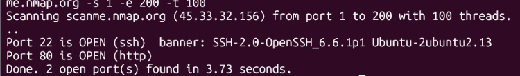

# Python Port Scanner

A multithreaded TCP port scanner written in Python. It checks which ports are open on a host, identifies the service, and grabs banners to show what software is running. I built it to learn how networking and tools like Nmap work.

> **Disclaimer:** Use this tool only on systems you own or have explicit permission to test. Scanning other people's systems without permission may be illegal. A safe practice target is `scanme.nmap.org`.

## Features

- Scans a range of TCP ports on any host or IP
- Multithreaded: 100 ports are checked at once by default
- Banner grabbing to identify service software and versions
- Retries on timeouts to reduce missed ports
- Input validation and clean error messages
- Optional output to a text file
- Unit tests with pytest

## Performance

Scanning ports 1-200 on `scanme.nmap.org`:

| Threads | Time |
|---|---|
| 1 | 84.89 s |
| 100 | 1.46 s |

That is about **58x faster**, with the same open ports found.

## Installation

git clone https://github.com/muskaaann36/python-port-scanner.git 
cd python-port-scanner
python3 -m venv venv
source venv/bin/activate
pip install -r requirements.txt

Python 3.8 or newer is recommended. The scanner uses only the standard library.

## Usage

python3 scanner.py <host> [-s START] [-e END] [-t THREADS] [-o OUTPUT]

Examples:

python3 scanner.py 127.0.0.1
python3 scanner.py scanme.nmap.org -s 1 -e 200
python3 scanner.py scanme.nmap.org -s 1 -e 1024 -t 50 -o results.txt

Example output:

Scanning scanme.nmap.org (45.33.32.156) from port 22 to 22 with 100 threads...
Port 22 is OPEN (ssh) banner: SSH-2.0-OpenSSH_6.6.1p1 Ubuntu-2ubuntu2.13
Done. 1 open port(s) found in 0.86 seconds.

## How it works

For each port, the scanner opens a TCP socket and tries to connect. If the handshake completes, a program is listening and the port is **open**. If the operating system refuses, the port is **closed**. If nothing comes back before the timeout, a firewall is probably dropping the traffic (**filtered**). Open ports are then read for a banner, which is the greeting some services send. A thread pool runs many of these checks at once, so the scan spends its time waiting in parallel instead of one port after another.

## Running the tests

pytest -v

## Known limitations

- TCP connect scans only. No UDP, and no stealth (SYN) scanning.
- Many threads can overload a network or trigger rate limiting, causing missed ports. Lowering `-t` improves accuracy.
- Service names come from the port number and are only a guess. The banner is more reliable.
- The "connection refused" check uses the Linux error code (111).

## Future ideas

- UDP scanning
- Output as JSON or CSV
- Scanning several hosts at once
- Version detection beyond simple banners

## What I learned

Sockets and the TCP handshake, threading for I/O-bound work, the trade-off between speed and accuracy, and writing tests with pytest.

## License

MIT
